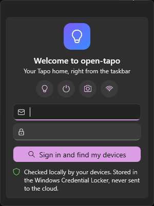
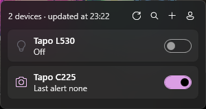

# open-tapo

[](https://github.com/Neotoxic-off/open-tapo/actions/workflows/release.yml)

A small Windows tray app to control your **TP-Link Tapo** lights, plugs, sensors and cameras **locally**, without the Tapo app and without going through the cloud.

<p align="center">
  
  &nbsp;&nbsp;
  
</p>

Click the icon next to the clock: a compact dark panel opens above the taskbar, one line per device. Click a line to unfold its settings (one at a time); click outside to close the panel.

## Download

Grab `OpenTapo.exe` from the [latest release](https://github.com/Neotoxic-off/open-tapo/releases/latest) and run it. It is a single self-contained file: no installer, no .NET to install. Releases are built, tested and signed by GitHub Actions with the project's self-signed certificate (thumbprint `A166886F5099962FC334670D311A3CE186EED6F0`), so you can check a download really comes from this repository. Windows does not trust a self-signed certificate: SmartScreen warns on first launch and shows an unknown publisher; choose **More info → Run anyway**.

## Features

Every control is driven by what the device reports: a feature a model does not answer for is simply hidden, so new models work without a model list.

**Bulbs, light strips, plugs, power strips, switches** (KLAP protocol)
- On / off, brightness
- White temperature presets and slider, colour presets, hue and saturation
- Fade on / off
- Energy for plugs that meter it: current power, today and this month
- Time switched on today, over 7 days and over 30 days, plus Wi-Fi signal

**Hubs (H100) and their sensors**
- One line per child device under the hub: temperature and humidity, motion, door / window contact, thermostat target, battery level, low battery, offline

**Cameras and doorbells** (Tapo secure camera API)
- Row switch: on = camera watching, off = privacy mode (lens covered)
- Battery level on the row for battery cameras (C410…), with charging and low-battery hints
- Motion and person detection, auto tracking, alarm on detection, siren, status LED, image flip, night vision mode
- Last alert, SD card usage, Wi-Fi signal

**App**
- First-run setup: sign in, then the network is scanned and your devices appear
- Automatic discovery, devices remembered between runs (sleeping battery cameras stay listed), or add one by IP
- Account stored in the Windows Credential Locker
- Refreshes every 30 s while the panel is open
- Single self-contained `.exe`, Windows 11 Fluent dark theme

## Requirements

- Windows 11 (x64)
- Your Tapo account email and password: the devices check them locally before they accept any command
- To build from source: the [.NET 10 SDK](https://dotnet.microsoft.com/download)

## Build and run

```powershell
dotnet publish src/OpenTapo -c Release
.\src\OpenTapo\bin\Release\net10.0-windows10.0.22621.0\win-x64\publish\OpenTapo.exe
```

`OpenTapo.exe` is self-contained: copy it anywhere and run it. Running it again while it is already open brings the panel up.

## Tests

```powershell
dotnet test tests/OpenTapo.Tests
```

- **Unit**: formatting, sensor readings, camera API payloads, converters.
- **Integration**: fake KLAP devices and fake cameras speaking the real protocols (handshakes, AES-CBC, `Tapo_tag`, device_confirm, lockout) on loopback addresses `127.0.0.x`, ports 28080, 443 and 20002, driven through the real clients, discovery, stores and view models.
- **Fuzz**: seeded random datagrams, JSON documents, encrypted payloads and raw HTTP bodies against every parser that reads LAN data. Any host can answer as a device, so a hostile reply must end as an error line, never a crash.

The run fails below 100 % line coverage (coverlet). The WPF shell (`App`, panel window, tray icon, window backdrop) needs a desktop session and is excluded. Tests never touch your account, `%LOCALAPPDATA%\OpenTapo` or your LAN: they use their own Credential Locker entry, a temporary folder and loopback devices only.

## Releases

GitHub Actions builds and tests every push and pull request. Pushing a `v*` tag also publishes the single-file exe, signs it with `signtool` and attaches it to a GitHub release. Signing needs two repository secrets: `CERT_PFX_BASE64` (the code-signing `.pfx`, base64) and `CERT_PASSWORD`.

Diagnostics: `OpenTapo.exe --probe` lists the devices found on the network and reads each one with the stored account. Errors the app cannot show are written to `%LOCALAPPDATA%\OpenTapo\error.log`.

## Usage notes

- **First launch** shows only a setup screen asking for your Tapo email and password. open-tapo then scans the network, checks the credentials against a device found there (a typo is reported right away), and only then shows your devices. Signing out returns to this screen.
- **Devices on recent firmware** may only accept TP-Link's newer TPAP protocol, which open-tapo does not support. Enable **Third-Party Compatibility** in the Tapo app's settings to turn the local protocols back on.
- **Cameras lock sign-in for about 30 minutes after 10 failed attempts.** open-tapo checks the password locally before completing a login and never retries a rejection: a camera that rejected the account is remembered, even after a restart, until you sign in again.
- **Battery cameras** sleep most of the time and are only reachable while awake. They also pick up a changed account password only once awake: if one rejects a password the other devices accept, wake it in the Tapo app for a minute, then sign in again.
- **Every device seen once is remembered**, so sleeping battery cameras stay listed and update as soon as they wake. A device discovery never sees (another subnet) can be added by IP with the **+** button.

## Tested devices

| Device | Firmware |
|---|---|
| Tapo L530E (colour bulb) | 1.4.4 |
| Tapo C225 (pan / tilt camera) | 1.3.2 |
| Tapo C410 (battery camera) | 1.2.1 |

Plugs, switches, hubs and sensors follow the same documented protocols but are untested on real hardware. Settings a device does not report are hidden.

## How it works

| Part | Detail |
|---|---|
| Discovery | UDP broadcast and unicast to port 20002 (the Tapo app's discovery packet), plus a TLS certificate check on port 443 (`TPRI-DEVICE` / `TAPO-DEVICE`) for cameras that do not answer UDP |
| Lights, plugs, hubs | KLAP v2 over HTTP: a two-step seed handshake proving both sides know `SHA256(SHA1(email) + SHA1(password))`, then AES-128-CBC requests signed with SHA-256 and a sequence number, batched with `multipleRequest` |
| Cameras | HTTPS login as `admin` with `encrypt_type 3` (client and device nonces, `device_confirm`), then `securePassthrough` AES-128-CBC requests authenticated by a `Tapo_tag` header. The camera checks the tag against the body as Python's `json.dumps` would print it, so the envelope is written in exactly that form |

## Security

- Credentials stay in the per-user Windows Credential Locker and are only sent to devices on your LAN. Nothing goes through the cloud.
- No password-derived value is sent to a device before it proves it knows the password hash.
- Device connections refuse HTTP redirects and cap response sizes, so a rogue host on the LAN cannot aim the app at other services.
- Known limits: the camera's self-signed certificate is accepted without pinning. KLAP exposes material that allows offline password guessing to anyone on the LAN, which is why TP-Link moved to TPAP. Camera responses are not integrity-protected by the protocol.

## Not supported

Live video, pan / tilt control, the TPAP protocol, battery cameras paired to an H200 hub (they are reached through the hub, not directly).

## Project layout

```
src/OpenTapo/
  Tapo/         protocol clients (KLAP, camera), discovery, camera API definitions
  Services/     credential store, device sessions, account check, known devices, rejected cameras
  ViewModels/   MVVM (CommunityToolkit.Mvvm: observable properties, relay commands, messenger)
  Views/        tray icon, panel, Fluent styles and device templates
  Diagnostics/  --probe and error log
tests/OpenTapo.Tests/
  Fakes/        loopback KLAP device and camera (Kestrel)
  Unit/  Integration/  Fuzz/
```

Code style: explicit types everywhere (`var` fails the build, enforced by `.editorconfig`), file-scoped namespaces, a single NuGet dependency pinned by a lock file.

## Disclaimer

open-tapo is an independent project. It is not affiliated with, endorsed by or supported by TP-Link. "Tapo" and "TP-Link" are trademarks of their respective owners. Use at your own risk.

## License

[GPL-3.0](LICENSE)
